# IMDb Movies: SQL Analysis with MySQL and Docker

An end-to-end SQL project built on real IMDb data: **12.9 million raw records** cleaned and
normalized into a relational schema of **636K movies**, then analyzed with joins, CTEs, window
functions and index optimization.

**Tech stack:** MySQL 8.4 · Docker Compose · DBeaver

## Project Workflow

1. **Environment:** MySQL runs in Docker (`docker-compose.yml`), so anyone can reproduce the setup.

   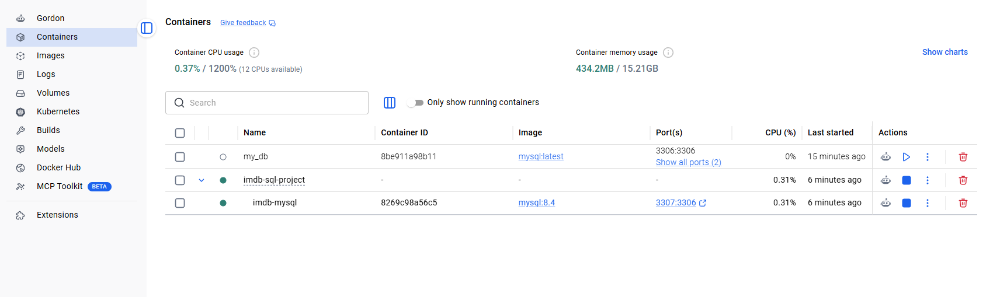
   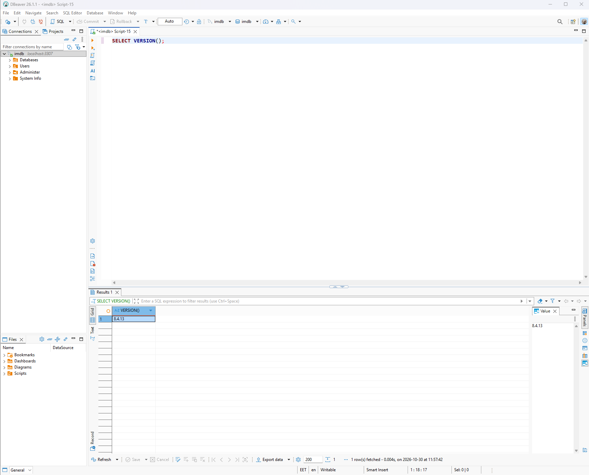

2. **Raw data:** the official [IMDb datasets](https://datasets.imdbws.com/) are bulk-loaded into
   staging tables with `LOAD DATA INFILE` (12.9M titles, 1.7M ratings).

   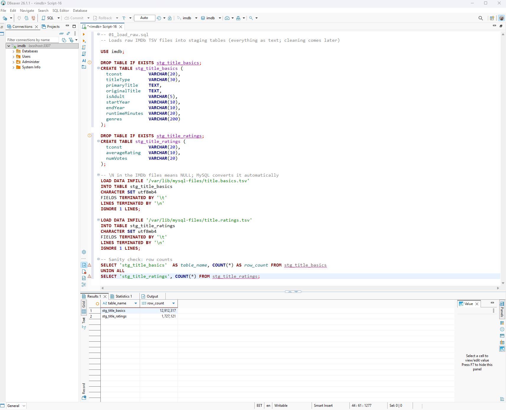

3. **Schema design:** a normalized model with a many-to-many relationship between movies and genres.

   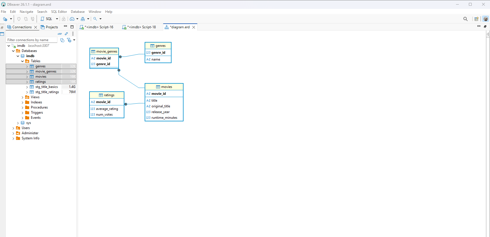

4. **Cleaning:** kept only non-adult feature films with a valid release year, replaced impossible
   runtimes with `NULL`, and split the comma-separated genre field into separate rows.

   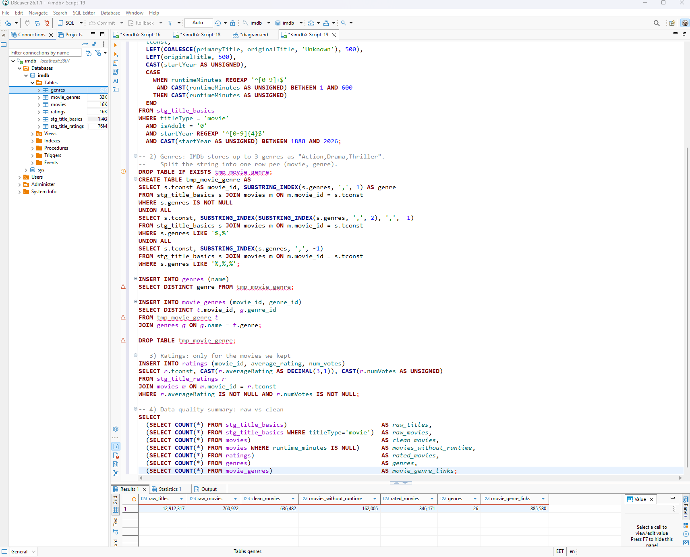

## Key Findings

**1. Highly voted classics dominate the top.**
Among movies with 100,000+ votes, the top 10 is led by The Shawshank Redemption (9.3, 3.26M votes),
The Godfather (9.2) and The Dark Knight (9.1). Six of the ten were released before 2000, and none
after 2010.

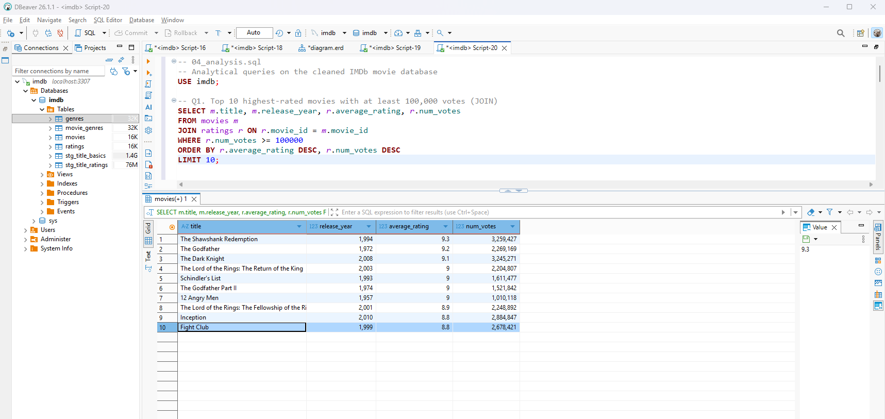

**2. Documentaries and biographies rate highest, horror lowest.**
Of the 23 genres with 500+ rated movies, News (7.18), Documentary (7.17) and Biography (6.92)
have the best average ratings. Horror (4.96), Sci-Fi (5.32) and Thriller (5.58) have the worst.
Drama is by far the largest genre: 158,064 rated movies with an average of 6.2.
*Caveat:* documentaries often have small, enthusiastic audiences, which can lift their averages.

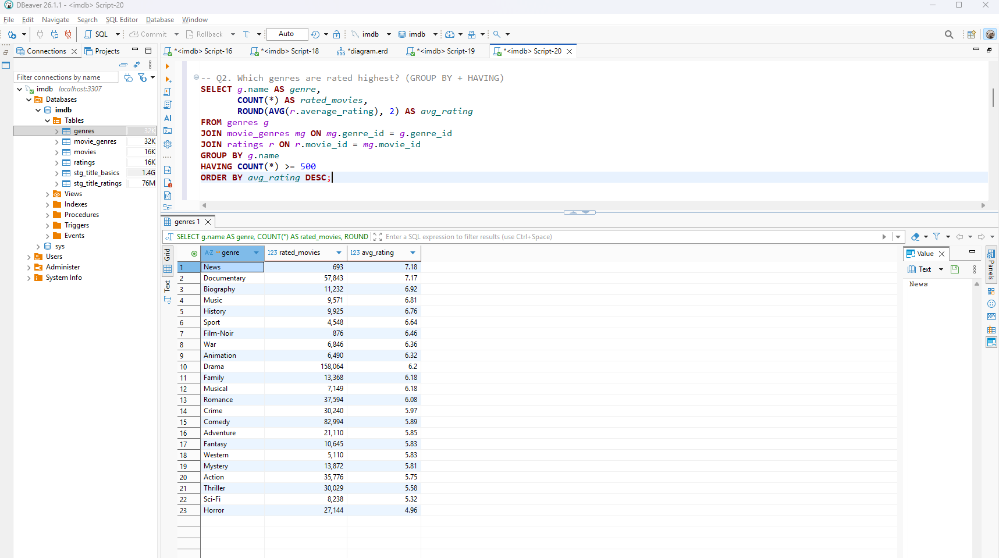

**3. Average ratings fall with every decade.**
For movies with 1,000+ votes, the average drops from 7.03 in the 1920s to about 6.1 in the 2010s
and 2020s, while the number of such movies grows from 244 to 14,555.
*Likely explanation:* survivorship bias. Only the best early films are still widely rated today.

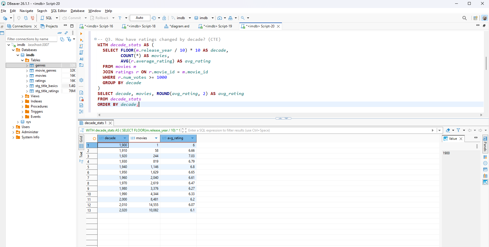

**4. One film can be the best in several genres.**
Schindler's List tops both History and Biography, The Return of the King tops both Adventure and
Fantasy, and Spirited Away tops both Animation and Family. This is why a many-to-many
`movie_genres` table is the right design.

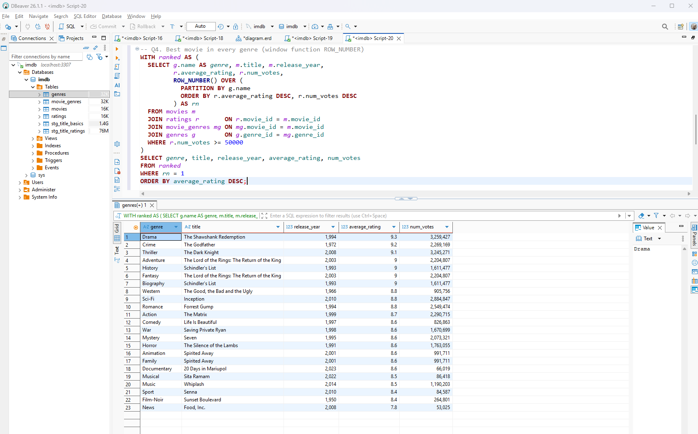

**5. Longer movies tend to get higher ratings.**
Average rating rises with every runtime bucket: 5.83 for movies under 90 minutes, 6.20 for 90-119,
6.69 for 120-149 and 6.82 for 150+ minutes (movies with 1,000+ votes). This is a correlation, not
a cause: long films are often big, prestige productions.

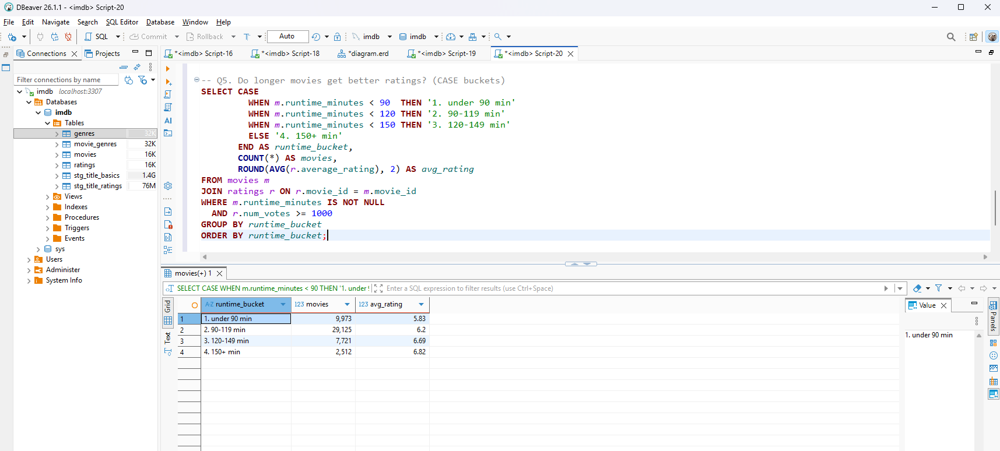

**6. Hidden gems come from outside Hollywood.**
Filtering for ratings of 8.0+ with only 5,000-25,000 votes (released 2020 or earlier), 8 of the
top 15 are Indian regional-language films (Telugu, Malayalam, Marathi), such as Mayabazar (1957),
Kireedam (1989) and C/o Kancharapalem (2018). Without the year filter, the list was dominated by
brand-new releases with inflated early ratings.

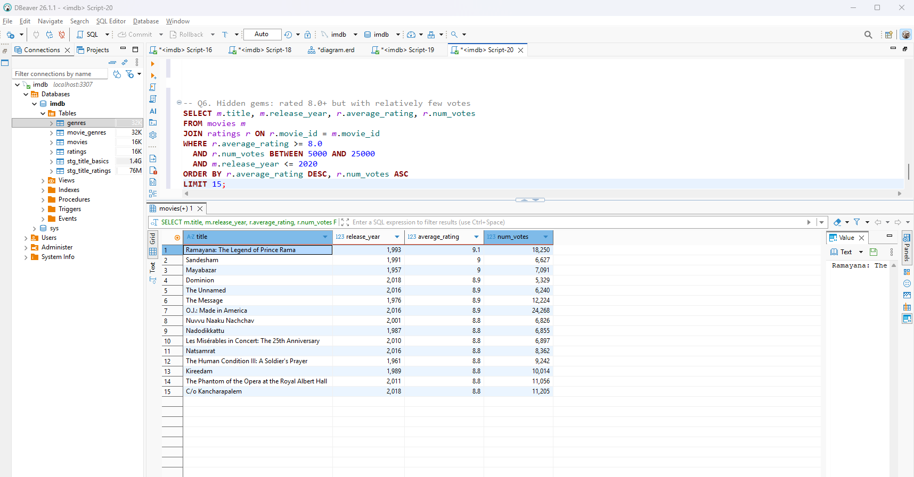

## Data Quality Summary

| Metric | Value |
|---|---|
| Raw IMDb titles | 12,912,317 |
| Raw titles of type "movie" | 760,922 |
| Clean movies (after filters) | 636,482 |
| Movies with a rating | 346,171 |
| Movies without runtime | 162,005 |
| Genres | 26 |

## Query Optimization

An index on `movies(release_year)` changed the query plan: before, MySQL did a full scan of
`ratings` (~339,615 estimated rows); after, it looks up the ~4,161 movies from 1994 directly
through the index, as shown by `EXPLAIN`. The optimizer's row estimates dropped roughly 80x.

| Before | After |
|---|---|
| 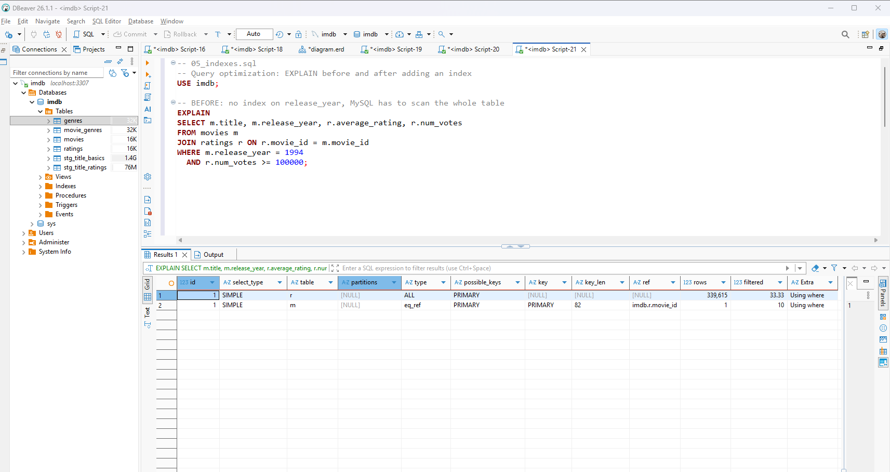 | 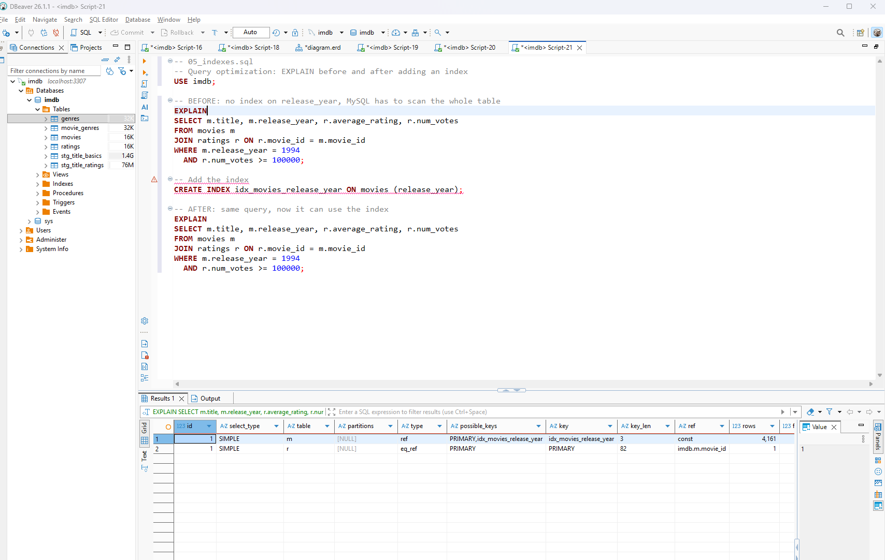 |

## How to Reproduce

1. Start MySQL: `docker compose up -d`
2. Download `title.basics.tsv.gz` and `title.ratings.tsv.gz` from
   [datasets.imdbws.com](https://datasets.imdbws.com/), unpack them, and put the `.tsv` files
   into the `data/` folder.
3. Connect with DBeaver (host `localhost`, port `3307`, database `imdb`, user `root`,
   password `rootpass`, a local demo password only).
4. Run the scripts in `sql/` in order:
   - `01_load_raw.sql`: staging tables and bulk load
   - `02_create_schema.sql`: normalized schema
   - `03_clean_and_load.sql`: cleaning and loading
   - `04_analysis.sql`: analytical queries
   - `05_indexes.sql`: `EXPLAIN` before and after an index

## SQL Skills Demonstrated

Schema design and normalization · many-to-many relationships · bulk loading · data cleaning
(regex, type casting, string splitting) · JOINs · aggregation with `GROUP BY` / `HAVING` ·
CTEs · window functions (`ROW_NUMBER`) · `CASE` · indexing and `EXPLAIN` · Docker-based setup.

## Data Source

[IMDb Non-Commercial Datasets](https://developer.imdb.com/non-commercial-datasets/), used here for
personal, non-commercial purposes. The data files are not included in this repository.
